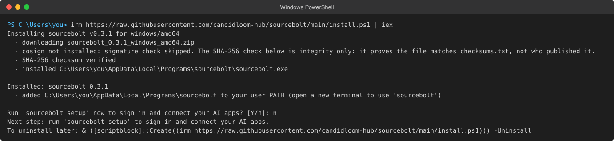
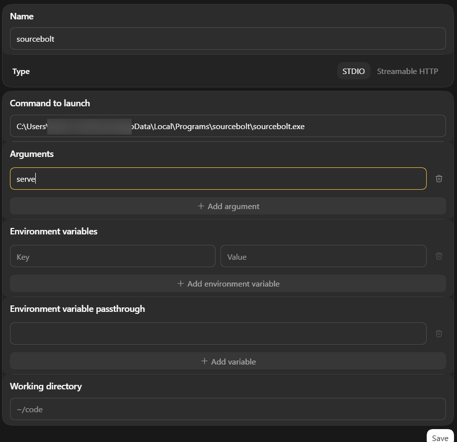
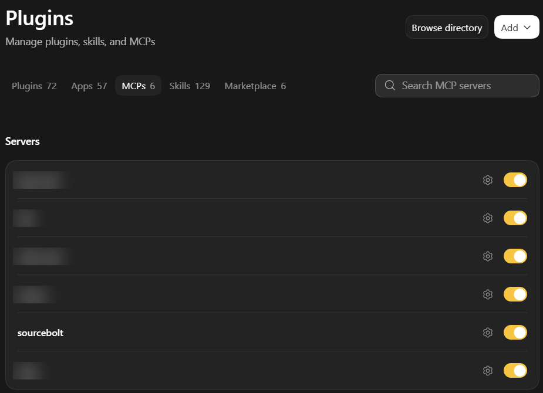
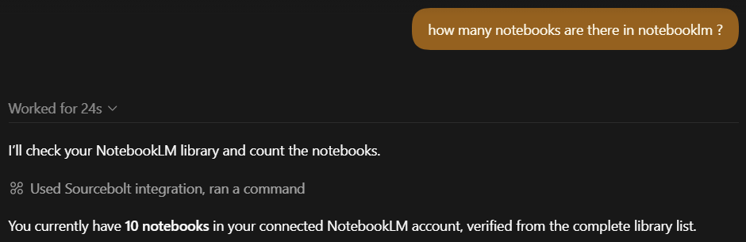

# Set up sourcebolt in the ChatGPT desktop app

<!-- Vendor facts checked 2026-10-21 at https://learn.chatgpt.com/docs/extend/mcp?surface=cli :
     desktop app supports STDIO servers; Settings > MCP servers > Add server (seen in the app on 2026-10-21 as
     Settings > Plugins > MCPs tab > Add; form: Name, Type, Command to launch, Arguments); name, STDIO or Streamable HTTP,
     command; Save, then Restart; /mcp in the composer lists connected servers; the desktop app, Codex CLI and
     IDE extension share ~/.codex/config.toml; `codex mcp add <name> -- <command>`; `enabled = false` turns a
     server off. The page does not document a remove command or a UI remove button, and does not say which
     operating systems support MCP in the desktop app. -->

This guide connects sourcebolt to the ChatGPT app installed on your computer. Then you can ask ChatGPT about your NotebookLM notebooks.

ChatGPT in a web browser cannot use sourcebolt. sourcebolt runs on your own computer, and the web version can only reach servers on the internet.

`sourcebolt setup` does not set up the ChatGPT app yet, so you add sourcebolt in the app's settings yourself. It takes one short form.

Choose one way:

1. [Easiest: one command plus one form](#easiest-one-command-plus-one-form) (about 3 minutes)
2. [Let ChatGPT guide you](#let-chatgpt-guide-you)
3. [Manual setup with Codex](#manual-setup-with-codex)

## Easiest: one command plus one form

### Step 1: Open a terminal

- **Windows:** click **Start**, type `PowerShell`, then click **Windows PowerShell**.
- **Mac:** press Command and Space together, type `Terminal`, then press Return.

You should see a window with a blinking cursor.


### Step 2: Install sourcebolt

Copy the line for your computer, paste it into the terminal, and press Enter.

Windows:

```powershell
irm https://raw.githubusercontent.com/candidloom-hub/sourcebolt/main/install.ps1 | iex
```

Mac:

```bash
curl -fsSL https://raw.githubusercontent.com/candidloom-hub/sourcebolt/main/install.sh | sh
```

The installer downloads sourcebolt, checks that the file is genuine, and installs it for your user only. You should see a line saying sourcebolt was installed, with its version number.

When it asks whether to run setup now, type `n` and press Enter.



### Step 3: Sign in to Google

Type this and press Enter:

```bash
sourcebolt login
```

A normal browser window opens on the Google sign-in page.

1. Sign in to Google in that window. Type your password there, and nowhere else.
2. Wait. When NotebookLM has loaded, the terminal shows a line that starts with `Saved profile`.


### Step 4: Add sourcebolt in ChatGPT

1. Find the full path of the sourcebolt program. In PowerShell, run:

   ```powershell
   (Get-Command sourcebolt).Source
   ```

   It is usually `C:\Users\<you>\AppData\Local\Programs\sourcebolt\sourcebolt.exe`. On a Mac, run `command -v sourcebolt` in Terminal instead.
2. Open the ChatGPT desktop app.
3. Open **Settings** (your profile picture, bottom left), then **Plugins**, then the **MCPs** tab.
4. Click **Add** (top right), choose the MCP server option, and fill in the form:
   - Name: `sourcebolt`
   - Type: **STDIO**
   - Command to launch: the full path from step 1
   - Arguments: `serve`
5. Click **Save**. Restart the app if it asks.



### Step 5: Check the connection

Go back to **Settings**, **Plugins**, **MCPs**. **sourcebolt** should be in the list with its switch on.



Now go to [How to check it works](#how-to-check-it-works).

## Let ChatGPT guide you

ChatGPT cannot run commands for you, but it can walk you through them one at a time. Copy the ChatGPT prompt from [Let your AI install it](../install-with-ai.md#chatgpt-desktop-app) and paste it into a new chat in the desktop app.

## Manual setup with Codex

The ChatGPT desktop app shares its MCP settings with Codex, OpenAI's coding assistant. If you have the Codex command installed, you can skip the form:

1. Install sourcebolt and sign in (steps 1 to 3 above).
2. Run:

   ```bash
   codex mcp add sourcebolt -- sourcebolt serve
   ```

   Or add this to the file `~/.codex/config.toml` in a text editor:

   ```toml
   [mcp_servers.sourcebolt]
   command = "sourcebolt"
   args = ["serve"]
   ```

3. Restart the ChatGPT app, then check the **MCPs** tab (step 5).

More options: [Connect your AI app](../clients.md#chatgpt).

## How to check it works

In a new chat in the ChatGPT desktop app, type:

> List my NotebookLM notebooks.

Allow the sourcebolt tool if ChatGPT asks. You should see your notebook names.



You can also type `sourcebolt doctor` in a terminal. Every line should start with `ok`.

## Undo / uninstall

1. **Remove sourcebolt from ChatGPT.** Open `~/.codex/config.toml` in a text editor and delete the `[mcp_servers.sourcebolt]` section (three lines), or add the line `enabled = false` under it to turn it off. Then restart the app.
2. **Delete your saved sign-in:** `sourcebolt logout`. This does not sign you out of Google.
3. **Delete the program.** If you used the one-line installer, run it again with the uninstall option. Windows (PowerShell):

   ```powershell
   & ([scriptblock]::Create((irm https://raw.githubusercontent.com/candidloom-hub/sourcebolt/main/install.ps1))) -Uninstall
   ```

   Mac:

   ```bash
   curl -fsSL https://raw.githubusercontent.com/candidloom-hub/sourcebolt/main/install.sh | sh -s -- --uninstall
   ```

   This also removes the PATH entry the installer added. Installed it another way (Homebrew, npm, Docker)? See [Install sourcebolt](../install.md) for its undo line.

## Something went wrong?

- `sourcebolt` is "not recognized" or "not found": close the terminal, open a new one, and try again.
- ChatGPT cannot start sourcebolt: in the form, use the full path of the program as the command. Find it with `(Get-Command sourcebolt).Source` in PowerShell or `command -v sourcebolt` on a Mac.
- Anything else: [Troubleshooting](../troubleshooting.md).
