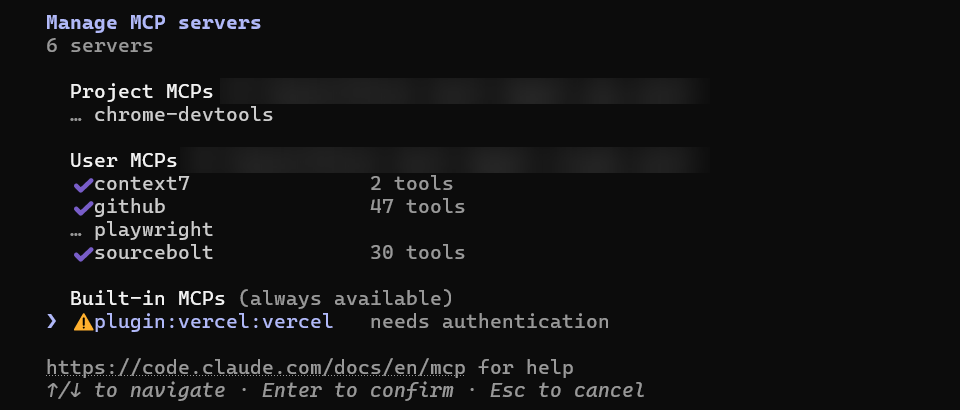
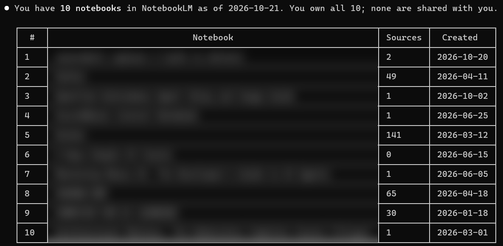

# Set up sourcebolt in Claude Code

<!-- Vendor facts checked 2026-10-21:
     claude mcp add/list/remove, --scope user, /mcp: https://code.claude.com/docs/en/mcp
     /plugin install --marketplace (v2.1.275+), /plugin uninstall, claude plugin uninstall:
       https://code.claude.com/docs/en/discover-plugins -->

This guide connects sourcebolt to Claude Code, the version of Claude that runs in a terminal (and inside VS Code and the Claude desktop app's Code tab). Then you can ask Claude about your NotebookLM notebooks.

Choose one way:

1. [Easiest: one command](#easiest-one-command) (about 2 minutes)
2. [Let Claude Code do it](#let-claude-code-do-it)
3. [Manual setup](#manual-setup)

## Easiest: one command

### Step 1: Open a terminal

- **Windows:** click **Start**, type `PowerShell`, then click **Windows PowerShell**.
- **Mac:** press Command and Space together, type `Terminal`, then press Return.
- **Linux:** press Ctrl, Alt and T together on most systems.

You should see a window with a blinking cursor. Use a new window, not the one where Claude Code is running.


<!-- screenshot: a fresh Windows PowerShell window opened from the Start menu, prompt visible, nothing typed yet -->

### Step 2: Install sourcebolt

Copy the line for your computer, paste it into the terminal, and press Enter.

Windows:

```powershell
irm https://raw.githubusercontent.com/candidloom-hub/sourcebolt/main/install.ps1 | iex
```

Mac and Linux:

```bash
curl -fsSL https://raw.githubusercontent.com/candidloom-hub/sourcebolt/main/install.sh | sh
```

The installer downloads sourcebolt, checks that the file is genuine, and installs it for your user only. You should see a line saying sourcebolt was installed, with its version number.


<!-- screenshot: terminal after the one-line installer ran: download and checksum lines, the "Installed: sourcebolt 0.x.y" line, and the question asking whether to run sourcebolt setup now -->

### Step 3: Connect Claude Code

The installer asks whether to run setup now. Type `y` and press Enter. (Missed it? Type `sourcebolt setup` and press Enter.)

Setup lists the AI apps it found. When it asks about **Claude Code**, answer yes. It saves a backup of Claude Code's settings before it changes them.


<!-- screenshot: terminal running sourcebolt setup: the list of detected apps with Claude Code in it, the yes/no question for Claude Code answered "y", and the backup confirmation line -->

### Step 4: Sign in to Google

Setup opens a normal browser window on the Google sign-in page.

1. Sign in to Google in that window. Type your password there, and nowhere else.
2. Wait. When NotebookLM has loaded, the terminal shows a line that starts with `Saved profile`.


<!-- screenshot: terminal after sign-in finished, showing 'Saved profile "default" for notebook.google.com (N notebooks visible).'. Blur the account name. -->

### Step 5: Restart Claude Code and check the connection

If Claude Code was open, type `/exit` and start it again with `claude`. Then type:

```text
/mcp
```

You should see **sourcebolt** with a status that says it is connected.


<!-- screenshot: Claude Code in a terminal after typing /mcp: the MCP server list with sourcebolt and a connected status -->

Now go to [How to check it works](#how-to-check-it-works).

## Let Claude Code do it

Claude Code can run all of the commands above for you and explain each one first. Copy the Claude Code prompt from [Let your AI install it](../install-with-ai.md#claude-code) and paste it into Claude Code.

## Manual setup

1. Install sourcebolt and sign in: do steps 1, 2 and 4 above, but answer `n` when the installer asks about setup. Then run:

   ```bash
   sourcebolt login
   ```

2. Pick one of these:

   - **Server only, for all your projects:**

     ```bash
     claude mcp add --scope user sourcebolt -- sourcebolt serve
     ```

   - **The sourcebolt plugin** (adds the server and a skill that teaches Claude which sourcebolt tool to use). Inside Claude Code 2.1.275 or later, type:

     ```text
     /plugin install sourcebolt --marketplace candidloom-hub/sourcebolt
     ```

     Claude Code asks you to confirm the marketplace and choose a scope. Choose **Install for you (user scope)**.

3. Check with `claude mcp list` in a terminal, or `/mcp` inside Claude Code.

No installer? With Node.js 18 or newer you can skip the program and use npm instead: `claude mcp add --scope user sourcebolt -- npx -y sourcebolt serve`. You still need to sign in once with `npx -y sourcebolt login`.

More options: [Connect your AI app](../clients.md#claude-code).

## How to check it works

In Claude Code, type:

> List my NotebookLM notebooks.

Claude asks for permission to use a sourcebolt tool the first time. Allow it. You should see your notebook names.


<!-- screenshot: Claude Code showing the prompt "List my NotebookLM notebooks.", the sourcebolt notebook_list tool call, and the reply listing notebooks. Use a test account or blur the titles. -->

You can also type `sourcebolt doctor` in a terminal. Every line should start with `ok`.

## Undo / uninstall

1. **Remove sourcebolt from Claude Code.** If you used setup:

   ```bash
   sourcebolt setup --undo
   ```

   If you added it yourself: `claude mcp remove sourcebolt`. For the plugin: type `/plugin uninstall sourcebolt@sourcebolt` inside Claude Code.
2. **Delete your saved sign-in:** `sourcebolt logout`. This does not sign you out of Google.
3. **Delete the program.** Windows (PowerShell):

   ```powershell
   Remove-Item (Get-Command sourcebolt).Source
   ```

   Mac and Linux:

   ```bash
   rm "$(command -v sourcebolt)"
   ```

## Something went wrong?

- `sourcebolt` is "not recognized" or "not found": close the terminal, open a new one, and try again.
- `/mcp` shows sourcebolt as failed: run `sourcebolt doctor` in a terminal and read the first `FAIL` line.
- Anything else: [Troubleshooting](../troubleshooting.md).
