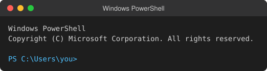
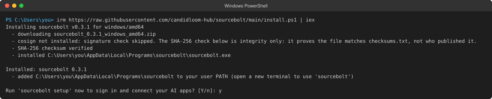
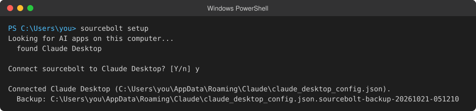
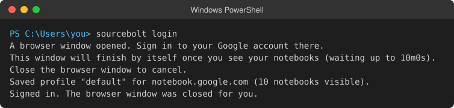

# Set up sourcebolt in Claude Desktop

<!-- Vendor facts checked 2026-10-21:
     Settings > Developer > Edit Config, config paths, "+" > Connectors > Manage connectors, log paths:
       https://modelcontextprotocol.io/docs/develop/connect-local-servers
     Settings > Extensions > Advanced settings > Install Extension..., "+" > Connectors:
       https://support.claude.com/en/articles/10949351-getting-started-with-local-mcp-servers-on-claude-desktop -->

This guide connects sourcebolt to the Claude Desktop app on Windows or Mac. Then you can ask Claude about your NotebookLM notebooks.

Choose one way:

1. [Easiest: one command](#easiest-one-command) (about 2 minutes)
2. [Let Claude guide you](#let-claude-guide-you)
3. [Manual setup](#manual-setup)

## Easiest: one command

### Step 1: Open a terminal

A terminal is a window where you type commands.

- **Windows:** click **Start**, type `PowerShell`, then click **Windows PowerShell**.
- **Mac:** press Command and Space together, type `Terminal`, then press Return.

You should see a window with a blinking cursor.



### Step 2: Install sourcebolt

Copy the line for your computer, paste it into the terminal, and press Enter.

Windows:

```powershell
irm https://raw.githubusercontent.com/candidloom-hub/sourcebolt/main/install.ps1 | iex
```

Mac:

```bash
curl -fsSL https://raw.githubusercontent.com/candidloom-hub/sourcebolt/main/install.sh | sh
```

The installer downloads sourcebolt, checks that the file is genuine, and installs it for your user only. You should see a line saying sourcebolt was installed, with its version number.



### Step 3: Connect Claude Desktop

The installer asks whether to run setup now. Type `y` and press Enter.

If you missed the question, type this and press Enter:

```bash
sourcebolt setup
```

Setup lists the AI apps it found on your computer. When it asks about **Claude Desktop**, answer yes. It saves a backup of Claude Desktop's settings before it changes them.



### Step 4: Sign in to Google

Setup now opens a normal browser window on the Google sign-in page.

1. Sign in to Google in that window. Type your password there, and nowhere else.
2. Wait. When NotebookLM has loaded, the window closes or says you can close it, and the terminal shows a line that starts with `Saved profile`.



### Step 5: Restart Claude Desktop

Claude Desktop reads its settings only when it starts. Quit it completely, then open it again.

- **Windows:** right-click the Claude icon near the clock (bottom right of the screen) and choose **Quit**. Closing the window is not enough.
- **Mac:** click **Claude** in the top menu bar, then **Quit Claude**.

### Step 6: Check that sourcebolt is connected

In Claude Desktop, click the **+** button at the bottom left of the message box. Point at **Connectors**, then click **Manage connectors**. You should see **sourcebolt** in the list.


<!-- screenshot: Claude Desktop chat window with the "+" menu open at the bottom-left of the message box, Connectors > Manage connectors open, sourcebolt visible and switched on -->

Now go to [How to check it works](#how-to-check-it-works).

## Let Claude guide you

Claude Desktop cannot run commands for you, but it can walk you through them one at a time. Copy the Claude Desktop prompt from [Let your AI install it](../install-with-ai.md#claude-desktop) and paste it into a new chat.

## Manual setup

Use this if you prefer to change the settings yourself.

### Option A: double-click the bundle

1. Open the [v0.3.3 release page](https://github.com/candidloom-hub/sourcebolt/releases/tag/v0.3.3).
2. Under **Assets**, download the `.mcpb` file for your computer:
   - Windows: `sourcebolt-mcp-windows-amd64.mcpb` (or `-arm64` on an ARM PC).
   - Mac with Apple silicon (M1 or newer): `sourcebolt-mcp-darwin-arm64.mcpb`. Older Intel Mac: `sourcebolt-mcp-darwin-amd64.mcpb`.
3. Double-click the file. Claude Desktop asks whether to install the extension. Click **Install**.

   If double-clicking does nothing, open Claude Desktop, then **Settings**, **Extensions**, **Advanced settings**, and under **Extension Developer** click **Install Extension...** and pick the file.

4. Sign in once. The bundle has its own copy of sourcebolt, but signing in needs a terminal. Do steps 1, 2 and 4 of [Easiest: one command](#easiest-one-command), but answer `n` when the installer asks about setup, and then run:

   ```bash
   sourcebolt login
   ```

5. Restart Claude Desktop.

### Option B: edit the settings file

1. Install sourcebolt and sign in: steps 1, 2 and 4 of [Easiest: one command](#easiest-one-command), answering `n` to setup, then run `sourcebolt login`.
2. In Claude Desktop, open **Settings** (from the **Claude** menu on Mac, or the menu in the top left on Windows), then **Developer**, then **Edit Config**. This shows the file `claude_desktop_config.json`.
   - Windows: `%APPDATA%\Claude\claude_desktop_config.json`
   - Mac: `~/Library/Application Support/Claude/claude_desktop_config.json`
3. Open the file in a text editor. If it is empty, paste this. If it already has an `"mcpServers"` section, add only the `"sourcebolt"` line inside it.

   ```json
   {
     "mcpServers": {
       "sourcebolt": { "command": "sourcebolt", "args": ["serve"] }
     }
   }
   ```

4. Save the file and restart Claude Desktop.

More details and the log file locations: [Connect your AI app](../clients.md#claude-desktop).

## How to check it works

Start a new chat in Claude Desktop and type:

> List my NotebookLM notebooks.

Claude asks for permission to use a sourcebolt tool the first time. Allow it. You should see your notebook names.


<!-- screenshot: Claude Desktop chat showing the prompt "List my NotebookLM notebooks.", the collapsed sourcebolt notebook_list tool call, and the answer listing notebooks. Use a test account or blur the titles. -->

You can also check from the terminal. Type `sourcebolt doctor` and press Enter. Every line should start with `ok`.

## Undo / uninstall

1. **Remove sourcebolt from Claude Desktop.** If you used setup, run:

   ```bash
   sourcebolt setup --undo
   ```

   This puts back the settings backup that setup saved. If you used the bundle, open **Settings**, **Extensions**, click **sourcebolt** and remove it there. If you edited the file yourself, delete the `"sourcebolt"` line.
2. **Delete your saved sign-in:**

   ```bash
   sourcebolt logout
   ```

   This deletes sourcebolt's copy of your session. It does not sign you out of Google.
3. **Delete the program.** If you used the one-line installer, run it again with the uninstall option. Windows (PowerShell):

   ```powershell
   & ([scriptblock]::Create((irm https://raw.githubusercontent.com/candidloom-hub/sourcebolt/main/install.ps1))) -Uninstall
   ```

   Mac:

   ```bash
   curl -fsSL https://raw.githubusercontent.com/candidloom-hub/sourcebolt/main/install.sh | sh -s -- --uninstall
   ```

   This also removes the PATH entry the installer added. Installed it another way (Homebrew, npm, Docker)? See [Install sourcebolt](../install.md) for its undo line.

4. Restart Claude Desktop.

## Something went wrong?

- `sourcebolt` is "not recognized" or "not found": close the terminal, open a new one, and try again.
- sourcebolt does not show up in Claude Desktop: quit Claude Desktop completely (step 5) and open it again.
- Anything else: [Troubleshooting](../troubleshooting.md).
