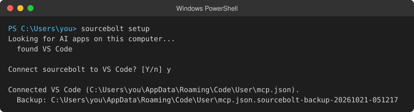
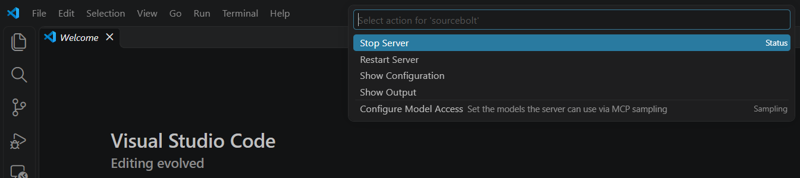
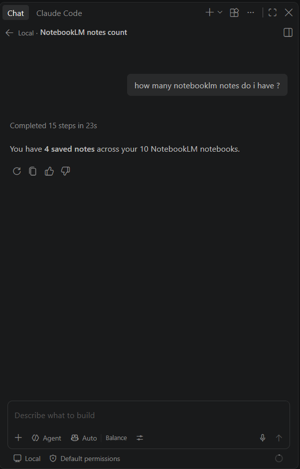

# Set up sourcebolt in VS Code

<!-- Vendor facts checked 2026-10-21:
     Chat menu > Open Chat, Ctrl+Alt+I (Windows) / Ctrl+Cmd+I (macOS), Agent control in the chat input:
       https://code.visualstudio.com/docs/agents/run/chat-view
     MCP: List Servers, Start/Stop/Restart/Disable/Uninstall/Show Output, MCP: Reset Trust:
       https://code.visualstudio.com/docs/agents/run/manage-mcp-servers
     code --add-mcp (writes the user profile), MCP: Open User Configuration, "servers" key:
       https://code.visualstudio.com/docs/agents/reference/mcp-configuration
     MCP: Add Server, Configure Tools: https://code.visualstudio.com/docs/copilot/customization/mcp-servers -->

This guide connects sourcebolt to Visual Studio Code (VS Code), for use with GitHub Copilot Chat. Then you can ask Copilot about your NotebookLM notebooks.

Choose one way:

1. [Easiest: one command](#easiest-one-command) (about 2 minutes)
2. [Let Copilot do it](#let-copilot-do-it)
3. [Manual setup](#manual-setup)

## Easiest: one command

### Step 1: Open a terminal

- **Windows:** click **Start**, type `PowerShell`, then click **Windows PowerShell**.
- **Mac:** press Command and Space together, type `Terminal`, then press Return.
- **Linux:** press Ctrl, Alt and T together on most systems.

You should see a window with a blinking cursor.


### Step 2: Install sourcebolt

Copy the line for your computer, paste it into the terminal, and press Enter.

Windows:

```powershell
irm https://raw.githubusercontent.com/candidloom-hub/sourcebolt/main/install.ps1 | iex
```

Mac and Linux:

```bash
curl -fsSL https://raw.githubusercontent.com/candidloom-hub/sourcebolt/main/install.sh | sh
```

The installer downloads sourcebolt, checks that the file is genuine, and installs it for your user only. You should see a line saying sourcebolt was installed, with its version number.


### Step 3: Connect VS Code

The installer asks whether to run setup now. Type `y` and press Enter. (Missed it? Type `sourcebolt setup` and press Enter.)

Setup lists the AI apps it found. When it asks about **VS Code**, answer yes. It saves a backup of VS Code's MCP settings before it changes them.



### Step 4: Sign in to Google

Setup opens a normal browser window on the Google sign-in page.

1. Sign in to Google in that window. Type your password there, and nowhere else.
2. Wait. When NotebookLM has loaded, the terminal shows a line that starts with `Saved profile`.


<!-- screenshot: terminal after sign-in finished, showing 'Saved profile "default" for notebook.google.com (N notebooks visible).'. Blur the account name. -->

### Step 5: Start sourcebolt in VS Code

1. Restart VS Code.
2. Press Ctrl+Shift+P (Cmd+Shift+P on a Mac) to open the Command Palette.
3. Type `MCP: List Servers` and press Enter.
4. Click **sourcebolt**, then **Start Server**. If VS Code asks whether you trust the server, check that it runs `sourcebolt serve`, then allow it.


<!-- screenshot: VS Code Command Palette after running "MCP: List Servers", sourcebolt selected, its action list open showing Start Server (or Running state) -->

Now go to [How to check it works](#how-to-check-it-works).

## Let Copilot do it

Copilot Chat with the **Agent** selected can run the commands above for you and explain each one first. Copy the VS Code prompt from [Let your AI install it](../install-with-ai.md#vs-code) and paste it into the Chat view.

## Manual setup

1. Install sourcebolt and sign in: do steps 1, 2 and 4 above, but answer `n` when the installer asks about setup. Then run:

   ```bash
   sourcebolt login
   ```

2. Add sourcebolt to VS Code. Either:

   - **From a terminal (Mac and Linux):**

     ```bash
     code --add-mcp '{"name":"sourcebolt","type":"stdio","command":"sourcebolt","args":["serve"]}'
     ```

     From Windows PowerShell:

     ```powershell
     code --% --add-mcp "{\"name\":\"sourcebolt\",\"type\":\"stdio\",\"command\":\"sourcebolt\",\"args\":[\"serve\"]}"
     ```

   - **Settings file:** in VS Code, open the Command Palette and run `MCP: Open User Configuration`. Add sourcebolt inside the `"servers"` section (VS Code uses `servers`, not `mcpServers`):

     ```json
     {
       "servers": {
         "sourcebolt": { "type": "stdio", "command": "sourcebolt", "args": ["serve"] }
       }
     }
     ```

3. Start the server (step 5 above).

More options: [Connect your AI app](../clients.md#vs-code) and [one-click install links](../install-links.md).

## How to check it works

1. Open the Chat view: the **Chat** menu, then **Open Chat** (or Ctrl+Alt+I on Windows, Ctrl+Cmd+I on a Mac).
2. In the controls under the message box, choose **Agent**.
3. Type:

   > List my NotebookLM notebooks.

VS Code asks before it runs a sourcebolt tool. Allow it. You should see your notebook names.


<!-- screenshot: VS Code Chat view with Agent selected, the prompt "List my NotebookLM notebooks.", the allowed sourcebolt notebook_list tool call, and the reply listing notebooks. Use a test account or blur the titles. -->

You can also type `sourcebolt doctor` in a terminal. Every line should start with `ok`.

## Undo / uninstall

1. **Remove sourcebolt from VS Code.** If you used setup:

   ```bash
   sourcebolt setup --undo
   ```

   If you added it yourself: run `MCP: List Servers`, click **sourcebolt**, then **Uninstall** (or delete its entry from the file that `MCP: Open User Configuration` opens).
2. **Delete your saved sign-in:** `sourcebolt logout`. This does not sign you out of Google.
3. **Delete the program.** If you used the one-line installer, run it again with the uninstall option. Windows (PowerShell):

   ```powershell
   & ([scriptblock]::Create((irm https://raw.githubusercontent.com/candidloom-hub/sourcebolt/main/install.ps1))) -Uninstall
   ```

   Mac and Linux:

   ```bash
   curl -fsSL https://raw.githubusercontent.com/candidloom-hub/sourcebolt/main/install.sh | sh -s -- --uninstall
   ```

   This also removes the PATH entry the installer added. Installed it another way (Homebrew, npm, Docker)? See [Install sourcebolt](../install.md) for its undo line.

## Something went wrong?

- `sourcebolt` is "not recognized" or "not found": close the terminal, open a new one, and try again.
- sourcebolt does not start: run `MCP: List Servers`, click **sourcebolt**, then **Show Output**, and read the last lines.
- Anything else: [Troubleshooting](../troubleshooting.md).
